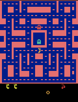
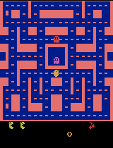
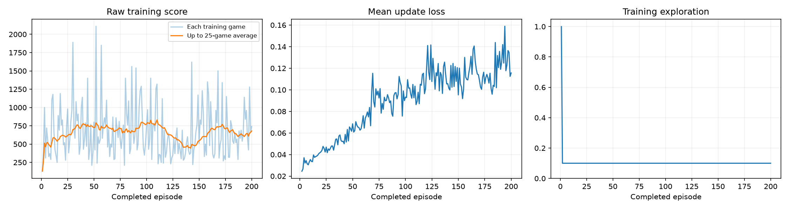

# Ms. Pac-Man Deep Q-Network Agent

Training a Deep Q-Network (DQN) in PyTorch to play Atari Ms. Pac-Man (`ALE/MsPacman-v5`). I picked and justified three hyperparameters, ran a full 200-episode training run on CPU, and evaluated the trained agent against an untrained baseline on five fixed seeds.

**Result:** the trained agent's mean score went from **492 to 728 (+48%)** across 5 evaluation games. The gain was uneven: one game scored 1,910, and two of the five seeds came in below the baseline. I discuss the reason (training instability) and the experiment I'd run next [below](#limitation-and-next-experiment).

| Untrained agent | Trained agent (best evaluation game) |
|:---:|:---:|
|  |  |

**Stack:** Python · PyTorch · Gymnasium + ALE (Atari) · NumPy · Matplotlib · Jupyter

> *Project context:* built as a reinforcement-learning course project. The DQN implementation is the course's starter notebook. My work was the experiment: choosing and justifying the hyperparameters, running the full training, evaluating the results and analyzing what happened.

## How to run it

The notebook (`pacman_dqn.ipynb`) is the class's starter notebook, unmodified except for the three
values in section 1.

- **Google Colab:** [Open pacman_dqn.ipynb in Colab](https://colab.research.google.com/github/vivekkhedkar-oss/mspacman-dqn-agent/blob/main/pacman_dqn.ipynb), select a GPU under Runtime → Change runtime type, and choose Runtime → Run all.
- **Local Jupyter / VS Code:** clone this repo, open `pacman_dqn.ipynb`, select a Python 3.11–3.13 kernel, and Run All. The notebook installs its own pinned packages (PyTorch, Gymnasium, ALE-Py, OpenCV, NumPy, Matplotlib, Pillow) and auto-detects CUDA / MPS / CPU.

This run was executed locally on **CPU** (Windows, no CUDA-capable GPU available) with a Python 3.12.14
virtual environment, using `jupyter nbconvert --execute --inplace`.

## My three hyperparameters

| Hyperparameter | Value | Why |
|---|---|---|
| Exploration | **0.10** | After the 1,000-decision warm-up, only 10% of training moves are random (vs. the notebook's 20% default). With a 200-episode budget I wanted the agent to spend more of its limited training exploiting what it had already learned, rather than spending a fifth of every game moving randomly. |
| Episodes | **200** | Double the notebook's starting value of 100. A CPU run of ~100 episodes is fast but leaves the network barely past warm-up; 200 episodes was the largest budget I judged feasible in a single CPU session (it took about 80 minutes) while still giving the network meaningfully more experience and learning updates. |
| Learning rate | **0.00025** | The learning rate used in the original DQN Atari paper (2.5×10⁻⁴), which is 2.5× the notebook's reference value of 0.0001. With more episodes already added, I wanted updates large enough to make visible progress within that budget, accepting the risk that a bigger step size is less stable. |

These three values were the only edits made to the notebook; section 1's code cell shows them exactly as run.

## What I expected vs. what I observed

**Expected:** with more training episodes than the default and a somewhat larger learning rate, I
expected the raw training score to trend upward over the 200 episodes, with periodic dips (Ms. Pac-Man's
scoring is inherently noisy, since it depends on ghost proximity, power pellet timing, and maze layout),
and I expected the trained agent's mean evaluation score to beat the untrained baseline, but not by an
enormous margin — DQN on Atari benchmarks typically needs many thousands of episodes for strong play.

**Observed:** the training score plot below (`training_dashboard.png`) shows a noisy but real upward
trend in the 25-game rolling average, climbing from around 130 near the start to a plateau around
650–800 for most of training, with a mid-run dip around episode 140 before recovering by episode 200.
Training loss climbed steadily from about 0.03 to 0.10–0.16 over the run rather than settling — with
only 5,000 replay transitions and a 2.5×10⁻⁴ learning rate, the Q-value estimates kept growing rather
than converging, which is a known instability mode for DQN with small replay buffers. The evaluation
result (below) matches this: the trained agent's mean score improved over the untrained baseline, but
it did not beat the baseline on every one of the five evaluation seeds.

## Actual training budget

From `training_summary.json`, produced by the notebook itself:

| Metric | Value |
|---|---|
| Completed episodes | 200 / 200 requested (run completed, not interrupted) |
| Total decisions (agent moves) | 119,167 |
| Learning updates | 29,542 |
| Elapsed time (training + periodic demo GIFs) | 4,813 seconds (≈ 80 minutes) |
| Hardware | CPU only — Windows 11, no CUDA GPU |
| Software | Python 3.12.14, PyTorch 2.14.0+cpu, Gymnasium 1.3.0, ALE-Py 0.11.2 |

Full details, including every package version, are in [`results/config.json`](results/config.json).

## Evaluation: before vs. after training

Both evaluations used the notebook's unchanged settings: the same five seeds, 5% exploration, and the
3,000-decision step cap. The baseline is the **untrained network**, not a random-action agent. None of
the ten evaluation games hit the step cap (`time_limited: false` for all), so every score reflects an
actual game over.

| Seed | Untrained (before) | Trained (after) |
|---|---:|---:|
| 101 | 350 | 590 |
| 202 | 500 | 530 |
| 303 | 320 | 1,910 |
| 404 | 800 | 350 |
| 505 | 490 | 260 |
| **Mean** | **492.0** | **728.0** |

Change in mean score: **+236.0 (+48%)**. Full scores and settings: [`results/comparison.json`](results/comparison.json).

The mean improved, but the trained agent actually scored *below* the untrained baseline on two of the
five seeds (404 and 505), while scoring far above it on seed 303 (1,910 vs. 320). One good game is
carrying the average — this is not a uniform, reliable improvement across seeds.

## Gameplay evidence

- **Untrained gameplay:** [`results/demos/episode_0000.gif`](results/demos/episode_0000.gif)
- **Best trained gameplay** (selected from the five evaluation games, first 20 seconds shown): [`results/demos/final_best.gif`](results/demos/final_best.gif)
- **Intermediate checkpoints** (every 25 episodes, since this run reached 200 episodes ≥ 25): [`episode_0025`](results/demos/episode_0025.gif) · [`episode_0050`](results/demos/episode_0050.gif) · [`episode_0075`](results/demos/episode_0075.gif) · [`episode_0100`](results/demos/episode_0100.gif) · [`episode_0125`](results/demos/episode_0125.gif) · [`episode_0150`](results/demos/episode_0150.gif) · [`episode_0175`](results/demos/episode_0175.gif) · [`episode_0200`](results/demos/episode_0200.gif)

## Training dashboard

Left: raw per-game training score (light) and its 25-game rolling average (orange) — noisy but trending
up overall. Middle: mean update loss per episode — trending upward rather than converging, consistent
with the small (5,000-transition) replay buffer and the larger learning rate. Right: training
exploration — 100% during the 1,000-decision warm-up, then flat at 10% for the rest of training, as configured.

## What the agent observes, does, and is rewarded for

- **Observations:** four stacked, grayscale 84×84 game screens (the last four frames the agent has seen), so the network can infer motion — e.g. which direction a ghost is moving — from a single input.
- **Actions:** the nine joystick moves available in Ms. Pac-Man (the four directions, four diagonals, and no-op), chosen by taking the highest-value action from the Q-network (or a random action during exploration).
- **Rewards:** raw in-game points (pellets, power pellets, fruit, and eating frightened ghosts), clipped to [-1, 1] only for the training update target — all scores reported above and in the plots are the true, unclipped game points.

## Limitation and next experiment

**Limitation:** the trained agent's evaluation performance is inconsistent across seeds — it beat the
untrained baseline on 3 of 5 evaluation games but lost to it on the other 2, and training loss never
stabilized, climbing for most of the run instead of leveling off. This points to instability from
combining a small (5,000-transition) replay buffer with a comparatively large learning rate (2.5×10⁻⁴):
the network is not seeing enough diverse past experience relative to how aggressively it updates, so its
Q-value estimates drift rather than converge.

**Next experiment:** I would drop the learning rate back toward the notebook's reference value of
0.0001, keeping exploration and episodes the same, to test whether smaller update steps produce a
flatter, more stable loss curve and a more consistent (lower-variance) improvement across all five
evaluation seeds, rather than a mean pulled up by a single standout game.

## Evidence and links

- Executed notebook (all outputs saved, not cleared): [`pacman_dqn.ipynb`](pacman_dqn.ipynb)
- Run config and package/hardware versions: [`results/config.json`](results/config.json)
- Per-episode training history: [`results/training.csv`](results/training.csv)
- Training summary (episodes, decisions, updates, elapsed time): [`results/training_summary.json`](results/training_summary.json)
- Before/after evaluation scores: [`results/comparison.json`](results/comparison.json)
- Untrained-baseline evaluation detail: [`results/baseline.json`](results/baseline.json)
- Intermediate demo scores (single-seed check every 25 episodes): [`results/demo_scores.json`](results/demo_scores.json)
- Training dashboard image: [`results/training_dashboard.png`](results/training_dashboard.png)

**Model checkpoints** (`untrained.pt`, `trained.pt`, and one per 25-episode interval, 6.5 MB each) are
not committed to this repository to keep it small. They are included in the full run ZIP attached to
this repository's [GitHub Release](https://github.com/vivekkhedkar-oss/mspacman-dqn-agent/releases), alongside every other file in `results/`.
